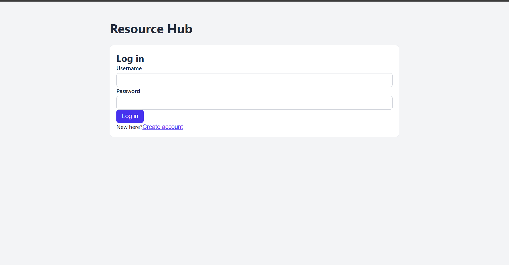
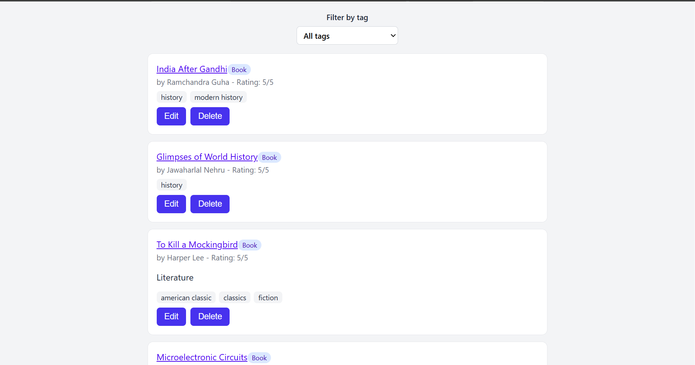
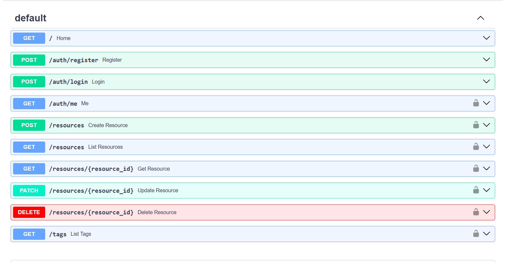

# Resource Hub

A research and reading resource hub where users register, log in, and keep a shared list of books, articles, videos and whitepapers, organised with tags.

Built as Assignment 3 (Phase 1): React frontend, FastAPI backend, PostgreSQL database, all run with Docker Compose.

## Features

- Register and log in (passwords hashed with Argon2, sessions use JWT tokens that expire after 60 minutes)
- Add a resource: title, author, type (Book, Article, Video, Whitepaper), URL, summary, optional rating (1-5) and tags
- Edit and delete resources (only the user who added a resource can change or delete it)
- Filter the list by tag
- Interactive API documentation at `/docs` (Swagger UI)

## Tech stack

| Part | Technology |
|---|---|
| Frontend | React (Vite), served by nginx in Docker |
| Backend | Python, FastAPI, SQLAlchemy 2.0, Pydantic |
| Database | PostgreSQL 16 |
| Auth | OAuth2 password flow, JWT (PyJWT), Argon2 (pwdlib) |
| Containers | Docker, Docker Compose |

## How it fits together

```
Browser (React app, port 5173)
        |  HTTP + JSON, Bearer token
        v
FastAPI backend (port 8000)
        |  SQLAlchemy
        v
PostgreSQL (port 5432, data kept in the pgdata volume)
```

## Run it with Docker

You need Docker Desktop and Git.

1. Clone the repo and enter it:

```
   git clone https://github.com/vikramkumardeo-rgb/resource-hub.git
   cd resource-hub
```

2. Create the two environment files from the examples.

   Windows (PowerShell):

```
   Copy-Item .env.example .env
   Copy-Item backend\.env.example backend\.env
```

   macOS / Linux:

```
   cp .env.example .env
   cp backend/.env.example backend/.env
```

3. Edit the files:
   - In `.env`, set a database password in `POSTGRES_PASSWORD`.
   - In `backend/.env`, set `SECRET_KEY` to a long random value. You can generate one with:

```
     python -c "import secrets; print(secrets.token_hex(32))"
```

4. Build and start everything:

```
   docker compose up -d --build
```

5. Open the app:
   - App: http://localhost:5173
   - API docs: http://localhost:8000/docs

On the first start the backend creates the database tables automatically. Click **Create account** on the login page to register your first user.

To stop the containers: `docker compose stop`. To remove them while keeping the data: `docker compose down`. Do not use `docker compose down -v`, because it deletes the database volume.

## API overview

| Method | Path | Description | Auth |
|---|---|---|---|
| GET | `/` | Health check | No |
| POST | `/auth/register` | Create an account | No |
| POST | `/auth/login` | Log in, returns a JWT access token | No |
| GET | `/auth/me` | Current user | Yes |
| GET | `/resources` | List resources, optional `?tag=name` filter | Yes |
| POST | `/resources` | Create a resource | Yes |
| GET | `/resources/{id}` | Get one resource | Yes |
| PATCH | `/resources/{id}` | Update a resource (owner only) | Yes |
| DELETE | `/resources/{id}` | Delete a resource (owner only) | Yes |
| GET | `/tags` | List all tags | Yes |

Errors use standard status codes: 201 created, 204 deleted, 400 bad request, 401 not logged in, 403 not the owner, 404 not found, 422 validation error.

## Data model

- `users`: id, username (unique), email (unique), hashed password
- `resources`: id, title, author, resource type, URL, summary, rating, submitted by (user), created at
- `tags`: id, name (unique, stored in lower case)
- `resource_tags`: link table, many-to-many between resources and tags

## Project structure

```
resource-hub/
├── docker-compose.yml
├── .env.example
├── backend/
│   ├── Dockerfile
│   ├── main.py          API routes
│   ├── models.py        database tables (SQLAlchemy)
│   ├── schemas.py       request/response validation (Pydantic)
│   ├── security.py      password hashing and JWT
│   ├── database.py      database connection
│   ├── create_tables.py creates the tables at startup
│   └── requirements.txt
└── frontend/
    ├── Dockerfile
    └── src/
        ├── App.jsx           main page and state
        ├── AuthForm.jsx      login / register
        ├── ResourceForm.jsx  add and edit form
        ├── ResourceList.jsx  resource cards
        └── api.js            calls to the backend
```

## Run without Docker (for development)

1. Start only the database: `docker compose up -d db`
2. Backend:

```
   cd backend
   python -m venv .venv
   .venv\Scripts\Activate.ps1
   pip install -r requirements.txt
   python create_tables.py
   uvicorn main:app --reload
```

3. Frontend (in a second terminal):

```
   cd frontend
   npm install
   npm run dev
```

## Screenshots





## Notes

- `.env` files hold secrets and are ignored by Git. Only the `.env.example` templates are committed.
- The frontend talks to the backend at `http://127.0.0.1:8000` (set in `frontend/src/api.js`), and the backend allows requests from `http://localhost:5173`.